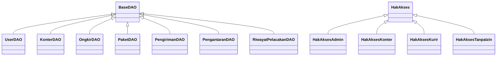

# JetExpress 


## 📦 Sistem Informasi Manajemen Pengiriman & Pelacakan Paket Dengan Aplikasi JetExpress


Proyek Akhir Mata Kuliah **Pemrograman Berorientasi Objek (PBO)** dan **Sistem Basis Data (SBD)**
Program Studi Sistem Informasi, Fakultas Teknik, Universitas Mulawarman.

## SDGs : 8. Decent Work and Economic Growth & 9. Industry, Innovation and Infrastructure


---

## Daftar Isi
 
1. [Deskripsi Singkat](#1-deskripsi-singkat)
2. [Fitur Utama Program](#2-fitur-utama-program)
3. [Tech Stack](#3-tech-stack)
4. [Perancangan Sistem](#4-perancangan-sistem)
5. [Struktur Folder / Package](#5-struktur-folder--package)
6. [Penerapan 4 Pilar OOP](#6-penerapan-4-pilar-oop)
7. [Cara Penggunaan Program](#7-cara-penggunaan-program)
8. [Kontributor](#8-kontributor)
---

## 1. Deskripsi Singkat
 
**JetExpress** adalah aplikasi desktop berbasis **Java Swing** untuk mengelola operasional perusahaan
ekspedisi **Jet** di Kota Samarinda, mulai dari penerimaan paket di konter, pencatatan pengiriman,
penugasan kurir, sampai pelacakan status paket oleh pelanggan.
 
**Latar belakang.** Banyak usaha ekspedisi masih mencatat pengiriman secara manual (misalnya dengan
spreadsheet). Akibatnya pencarian data lambat, pencatatan rawan salah, dan status pengiriman sulit dipantau.
Di sisi lain, pelanggan juga kesulitan mengetahui tarif dan posisi paketnya.
 
**Solusi.** JetExpress menyimpan seluruh data (user, konter, paket, pengiriman, ongkir, pengantaran, dan
riwayat pelacakan) di database MySQL yang saling berelasi, dengan pembagian hak akses untuk **Admin**,
**Petugas Konter**, **Kurir**, dan **Pengguna Umum**. Pengguna umum dapat mengecek tarif dan melacak paket
dengan nomor resi **tanpa login**.
 
**Relevansi SDGs.**
 
| SDG | Keterkaitan |
|---|---|
| **SDG 8** — Decent Work and Economic Growth | Meningkatkan efisiensi dan produktivitas kerja petugas lewat pencatatan terstruktur dan pembagian tugas yang jelas. |
| **SDG 9** — Industry, Innovation, and Infrastructure | Mendukung digitalisasi proses bisnis ekspedisi melalui sistem informasi terintegrasi. |
 
---

## 2. Fitur Utama Program

### 🌐 Pengguna Umum (tanpa login)
- **Lacak Paket** — telusuri status dan riwayat pengiriman memakai nomor resi.
- **Cek Tarif** — hitung estimasi ongkos kirim berdasarkan jarak dan berat paket.
- **Konter Kami** — lihat daftar konter Jet beserta alamat dan kontaknya.
### 🛠️ Admin
- **Dashboard** laporan sederhana.
- **CRUD** untuk seluruh data: User, Konter, Pengiriman, Paket, Ongkir, Riwayat Pelacakan, dan Pengantaran.
- Penugasan kurir pada pengantaran, dengan pemilihan titik tujuan di **peta** (latitude dan longitude).
- Peringatan yang ramah saat data tidak bisa dihapus karena masih dipakai data lain.
### 🧾 Petugas Konter
- Kelola data **Pengiriman**, **Paket**, dan **Riwayat Pelacakan**.
- Melihat informasi **Ongkir**, **Pengantaran**, dan **Konter**.
### 🛵 Kurir
- Melihat tugas pengantaran yang diberikan.
- Memperbarui status pengantaran: `Ditugaskan` → `Dalam Perjalanan` → `Berhasil` / `Gagal`.
- Melampirkan **foto bukti** pengantaran dan catatan kurir.
### ⚙️ Fitur Teknis
- Seluruh data dari database MySQL (tidak ada data yang di-hardcode).
- Validasi input (nomor HP, koordinat, tanggal) dan pembatasan menu berdasarkan peran.
- Peta OpenStreetMap untuk memilih koordinat tujuan pengantaran.
---

<details>
<summary>Fitur Utama Program</summary>
  
1. **Multi-Role Authentication**: Akses login berbeda untuk Admin, Petugas Konter, dan Kurir.


2. **Dashboard & Laporan Operasional**: Rekapitulasi jumlah pengiriman dan pengelolaan data sistem (khusus Admin).


3. **Manajemen Master Data (CRUD)**: Pengelolaan penuh data Konter, User, Tarif Ongkir, dan Kendaraan Kurir.


4. **Transaksi Pengiriman & Paket**: Pembuatan resi pengiriman, pencatatan data pengirim/penerima, kalkulasi biaya, dan manajemen metode pembayaran (Cash, Cashless, COD).


5. **Pelacakan (Tracking)**: Pembaruan dan monitoring *Riwayat Pelacakan* berdasarkan nomor resi yang dapat diakses publik.


6. **Manajemen Pengantaran**: Pembaruan status penugasan oleh kurir di lapangan beserta unggah bukti foto pengiriman.


7. **Peta Interaktif**: Integrasi rute dan visualisasi titik koordinat latitude/longitude menggunakan library JXMapViewer2.


</details>

---

## 3. Tech Stack
 
| Kategori | Teknologi |
|---|---|
| Bahasa | Java 17 |
| GUI | Java Swing (desktop) |
| Database | MySQL 8.0 |
| Build tool | Apache Maven |
| Driver database | MySQL Connector/J 9.3.0 (JDBC) |
| Library peta | JXMapViewer2 2.8 (OpenStreetMap) |
| Testing | JUnit Jupiter 5.10.3 |
| Arsitektur | MVC + DAO Pattern |
| IDE | Apache NetBeans |
| Tools perancangan | Oracle SQL Developer Data Modeler (ERD), draw.io (Use Case dan Flowchart), Figma (desain antarmuka), phpMyAdmin |
 
---

## 4. Perancangan Sistem
 
### Tabel Hak Akses
 
| Fitur | Pengguna Umum | Admin | Petugas Konter | Kurir |
|---|:---:|:---:|:---:|:---:|
| Login | – | ✅ | ✅ | ✅ |
| Lacak Paket (no. resi) | ✅ | ✅ | ✅ | ✅ |
| Cek Tarif | ✅ | ✅ | ✅ | ✅ |
| Lihat Konter | ✅ | ✅ | ✅ | ✅ |
| Dashboard / Laporan | ❌ | ✅ | ❌ | ❌ |
| Kelola User | ❌ | ✅ (CRUD) | ❌ | ❌ |
| Kelola Konter | ❌ | ✅ (CRUD) | 👁️ Lihat | ❌ |
| Kelola Ongkir | ❌ | ✅ (CRUD) | 👁️ Lihat | ❌ |
| Kelola Pengiriman | ❌ | ✅ (CRUD) | ✅ (CRUD) | ❌ |
| Kelola Paket | ❌ | ✅ (CRUD) | ✅ (CRUD) | ❌ |
| Kelola Riwayat Pelacakan | ❌ | ✅ (CRUD) | ✅ (CRUD) | ❌ |
| Kelola Pengantaran | ❌ | ✅ (CRUD) | ✅ (tambah/ubah/lihat) | 👁️ Lihat |
| Lihat tugas pengantaran | ❌ | ✅ | ✅ | ✅ |
| Ubah status dan unggah foto bukti | ❌ | ✅ | ❌ | ✅ |
 
> Keterangan: ✅ = akses penuh, 👁️ = hanya melihat, ❌ = tidak ada akses.
  
**Ringkasan relasi**
 
| Relasi | Kardinalitas |
|---|:---:|
| Konter — User | 1 : N |
| Konter — Pengiriman | 1 : N |
| Ongkir — Pengiriman | 1 : N |
| Pengiriman — Paket | 1 : 1 |
| Pengiriman — Riwayat Pelacakan | 1 : N |
| Pengiriman — Pengantaran | 1 : N |
| Kurir — Pengantaran | 1 : N |
| User → Admin / Petugas Konter / Kurir | Supertype – Subtype |
 
---

<details>
<summary><b>📌 Use Case Diagram</b> (klik untuk menampilkan)</summary>

<br>


</details>

<details>
<summary><b>🔄 Flowchart</b> (klik untuk menampilkan)</summary>

<br>

**Menu Utama**


**Menu Login**


**Menu Kurir**


**Menu Admin**


**Menu Petugas Konter**


**Link Flowchart**: <https://app.diagrams.net/#G1ZnnL7I5e6o7-vNZJKJbzveKaD8YHyKVH>
</details>


<details>
<summary><b>🗂️ ERD Logical</b> (klik untuk menampilkan)</summary>

<br>


</details>
  
<details>
<summary><b>🗃️ ERD Relational</b> (klik untuk menampilkan)</summary>

<br>


</details>


## 5. Struktur Folder / Package
 
```
JetExpress/
├── pom.xml
├── jetexpress.sql
├── README.md
├── docs/                         # diagram dan screenshot untuk dokumentasi
│   ├── erd/
│   ├── usecase/
│   ├── flowchart/
│   └── screenshots/
└── src/main/
    ├── java/
    │   ├── config/
    │   │   └── KoneksiDatabase.java
    │   ├── controller/
    │   │   ├── DashboardController.java
    │   │   ├── KonterController.java
    │   │   ├── LacakPaketController.java
    │   │   ├── LoginController.java
    │   │   ├── OngkirController.java
    │   │   ├── PengantaranController.java
    │   │   ├── PengirimanController.java
    │   │   ├── RiwayatPelacakanController.java
    │   │   └── UserController.java
    │   ├── dao/
    │   │   ├── BaseDAO.java
    │   │   ├── DashboardAdminDAO.java
    │   │   ├── KonterDAO.java
    │   │   ├── LacakPaketDAO.java
    │   │   ├── OngkirDAO.java
    │   │   ├── PaketDAO.java
    │   │   ├── PengantaranDAO.java
    │   │   ├── PengirimanDAO.java
    │   │   ├── RiwayatPelacakanDAO.java
    │   │   └── UserDAO.java
    │   ├── image/
    │   │   └── ImageManager.java      # simpan/hapus foto bukti pengantaran
    │   ├── main/
    │   │   └── Main.java
    │   ├── model/
    │   │   ├── Admin.java
    │   │   ├── BarisTabel.java        # interface
    │   │   ├── Konter.java
    │   │   ├── Kurir.java
    │   │   ├── Ongkir.java
    │   │   ├── Paket.java
    │   │   ├── Pengantaran.java
    │   │   ├── Pengiriman.java
    │   │   ├── PetugasKonter.java
    │   │   ├── RiwayatPelacakan.java
    │   │   └── User.java
    │   ├── util/
    │   │   ├── DatePickerKalender.java
    │   │   ├── FilterNomorHp.java
    │   │   ├── HakAkses.java          # abstract class
    │   │   ├── HakAksesAdmin.java
    │   │   ├── HakAksesKonter.java
    │   │   ├── HakAksesKurir.java
    │   │   ├── HakAksesTanpaIzin.java
    │   │   ├── InputHelper.java
    │   │   ├── KonversiWaktu.java
    │   │   ├── NavigasiHalaman.java   # interface
    │   │   ├── Sesi.java              # singleton
    │   │   ├── TeksPetunjuk.java
    │   │   ├── TemaJetExpress.java
    │   │   └── ValidasiKoordinat.java
    │   └── view/
    │       ├── MainFrame.java         # frame utama (CardLayout) + navigasi halaman
    │       ├── Login.java
    │       ├── MenuUtama.java
    │       ├── MenuAdmin.java
    │       ├── CekTarif.java
    │       ├── MenuCekTarif.java
    │       ├── LacakPaket.java
    │       ├── KonterKami.java
    │       ├── LihatDaftarKonter.java
    │       ├── LihatPengantaran.java
    │       ├── PanelPeta.java
    │       ├── KelolaKonter.java
    │       ├── KelolaOngkir.java
    │       ├── KelolaPengantaran.java
    │       ├── KelolaPengiriman.java
    │       ├── KelolaRiwayatPelacakan.java
    │       ├── KelolaUser.java
    │       ├── MenuKelolaKonter.java
    │       ├── MenuKelolaPenantaran.java
    │       ├── MenuKelolaPengiriman.java
    │       ├── MenuKelolaRiwayatPelacakan.java
    │       ├── MenuTambahDataPengiriman.java
    │       ├── MenuUbahDataPengiriman.java
    │       ├── TambahDataKurir.java
    │       ├── TambahDataPengantaran.java
    │       ├── TambahDataPengiriman.java
    │       ├── TambahDataPetugasKonter.java
    │       ├── UbahDataKurir.java
    │       ├── UbahDataPengantaran.java
    │       ├── UbahDataPengiriman.java
    │       ├── UbahDataPetugasKonter.java
    │       └── UbahStatusPengantaran.java
    └── resources/                     # ikon dan maskot (IconCekTarif, JetyBahagia, dst.)
```

> File `.form` pada package `view` adalah file desain NetBeans GUI Builder untuk tiap halaman, dan tidak ditampilkan di atas.
 
**Peran tiap package (MVC + DAO)**
 
| Package | Peran |
|---|---|
| `model` | Entitas yang merepresentasikan tabel database (data dan getter/setter). |
| `view` | Tampilan Java Swing; setiap halaman berupa `JPanel`, dihimpun oleh `MainFrame`. |
| `controller` | Penghubung antara `view` dan `dao`: validasi, aturan bisnis, dan penanganan error. |
| `dao` | Seluruh akses database (query JDBC) dengan DAO Pattern. |
| `config` | Konfigurasi dan pembuatan koneksi database (Singleton). |
| `util` | Helper: validasi input, hak akses per role, sesi login, tema, date picker. |
| `image` | Pengelolaan file foto bukti pengantaran. |
| `main` | Titik masuk aplikasi (`Main.java`). |
 
---

## 6. Penerapan 4 Pilar OOP
 
Proyek **JeteXpress** dikembangkan dengan bahasa **Java** menggunakan paradigma **Object-Oriented Programming (OOP)**.
Keempat pilar OOP, yaitu **Encapsulation**, **Inheritance**, **Polymorphism**, dan **Abstraction**, diterapkan
pada package `model`, `dao`, `util`, dan `view`. Berikut penjelasan tiap pilar beserta potongan kode dari program.
 
---
 
### 1. Encapsulation (Enkapsulasi)
 
**Konsep:** melindungi data agar tidak diakses langsung dari luar class. Atribut dibuat `private` dan hanya
diakses lewat method (getter/setter atau method khusus).
 
#### 📁 a. `Konter.java` (Package: `model`)
```java
public class Konter implements BarisTabel {
 
    private int idKonter;
    private String namaKonter;
    private String alamatKonter;
    private String kecamatan;
    private String callCenter;
 
    public String getNamaKonter() { return namaKonter; }
    public void setNamaKonter(String namaKonter) {
        this.namaKonter = namaKonter;
    }
    // ... getter dan setter atribut lainnya
}
```
Seluruh atribut entitas `Konter` bersifat `private`, sehingga data hanya dapat dibaca dan diubah lewat getter dan setter.
Pola yang sama dipakai pada class model lain seperti `User`, `Paket`, `Pengiriman`, `Pengantaran`, `Ongkir`, dan `RiwayatPelacakan`.
 
#### 📁 b. `Sesi.java` (Package: `util`)
```java
public final class Sesi {
 
    private static Sesi instance;
 
    private int idUser;
    private String nama;
    private String role;
    private int idKonter;
 
    private boolean peran(String peranDicari) {
        return role != null && role.trim().equalsIgnoreCase(peranDicari);
    }
 
    public boolean isAdmin() { return peran("Admin"); }
    public boolean isPetugasKonter() { return peran("Petugas Konter"); }
    public boolean isKurir() { return peran("Kurir"); }
}
```
Data user yang sedang login disimpan privat. Class lain tidak membaca atribut `role` langsung,
tetapi bertanya lewat method seperti `isAdmin()`, sehingga aturan pencocokan peran tetap terpusat di satu tempat.
 
#### 📁 c. `PengantaranDAO.java` (Package: `dao`)
```java
private void validasiStatus(String status, String bukti) {
    if (!List.of(Pengantaran.STATUS_DITUGASKAN,
            Pengantaran.STATUS_DALAM_PERJALANAN,
            Pengantaran.STATUS_BERHASIL,
            Pengantaran.STATUS_GAGAL).contains(status)) {
        throw new IllegalArgumentException("Status pengantaran tidak valid.");
    }
    if (Pengantaran.STATUS_GAGAL.equals(status)
            && (bukti == null || bukti.isBlank())) {
        throw new IllegalArgumentException(
                "Bukti foto wajib diisi jika pengantaran gagal.");
    }
}
```
Method validasi dibuat `private` karena hanya dipakai di dalam DAO. Pihak luar tidak bisa melewati aturan,
misalnya status harus salah satu dari empat nilai dan bukti foto wajib diisi bila pengantaran gagal.
 
🔎 Dengan atribut `private`, akses lewat method, dan validasi yang tersembunyi di dalam class, data user, pengiriman,
dan pengantaran hanya bisa diubah lewat jalur yang sudah ditentukan.
 
---
 
### 2. Inheritance (Pewarisan)
 
**Konsep:** class turunan mewarisi atribut dan method dari class induk sehingga kode dapat dipakai ulang.
 
#### 📁 a. `BaseDAO<T>` → seluruh DAO entitas
```java
public abstract class BaseDAO<T> {
    protected Connection bukaKoneksi() throws SQLException { ... }
    protected List<T> daftarHasil(String sql, Object... parameter) throws SQLException { ... }
    protected int perintah(String sql, Object... parameter) throws SQLException { ... }
    protected void jalankanTransaksi(BlokTransaksi blok) throws SQLException { ... }
}
```
```java
public class KonterDAO extends BaseDAO<Konter> {
 
    public boolean tambahKonter(Konter konter) throws SQLException {
        int jumlah = perintah(
                "INSERT INTO konter (nama_konter, alamat_konter, kecamatan, "
                + "call_center) VALUES (?, ?, ?, ?)",
                konter.getNamaKonter(), konter.getAlamatKonter(),
                konter.getKecamatan(), konter.getCallCenter());
        return jumlah > 0;
    }
}
```
`KonterDAO` memakai `perintah()` milik induknya tanpa menulis ulang kode koneksi, `PreparedStatement`, dan penutupan resource.
Pewarisan yang sama berlaku untuk `UserDAO`, `OngkirDAO`, `PaketDAO`, `PengirimanDAO`, `PengantaranDAO`, dan `RiwayatPelacakanDAO`.
 
#### 📁 b. `HakAkses` → `HakAksesAdmin`, `HakAksesKonter`, `HakAksesKurir`, `HakAksesTanpaIzin`
```java
public class HakAksesAdmin extends HakAkses {
 
    @Override
    protected Set<String> halamanIzin() {
        return Set.of("menuAdmin", "menuUser", "menuKonter", "menuOngkir",
                "menuPengiriman", "menuRiwayat", "menuPengantaran" /* ... */);
    }
 
    @Override
    public String halamanBeranda() { return "menuAdmin"; }
 
    @Override
    public String namaRole() { return "Admin"; }
}
```
Setiap role mewarisi aturan umum dari `HakAkses` (misalnya halaman publik dan method `bolehBuka()`),
lalu hanya mengisi daftar halaman yang diizinkan untuk role tersebut.
 
#### 📁 c. Pewarisan komponen Swing
```java
public class MainFrame extends JFrame implements NavigasiHalaman { ... }
public class Login extends javax.swing.JPanel { ... }
public class FilterNomorHp extends DocumentFilter { ... }
```
Seluruh halaman `view` mewarisi `JPanel`, `MainFrame` mewarisi `JFrame`, dan `FilterNomorHp` mewarisi `DocumentFilter`
agar input nomor HP hanya menerima angka.
 
#### 📁 d. Struktur hierarki pewarisan

 
> **Catatan:** hubungan supertype–subtype `User` → `Admin`, `Petugas Konter`, `Kurir` pada ERD diwujudkan dengan
> **komposisi**. Contohnya `Kurir` memuat atribut `nomorKendaraan` dan menyimpan objek `User` (`private User user`).
 
🔎 Pewarisan membuat kode akses database tidak berulang di setiap DAO, dan membuat penambahan role baru cukup dengan satu class `HakAkses*` baru.
 
---
 
### 3. Polymorphism (Polimorfisme)
 
**Konsep:** method dengan nama yang sama dapat berperilaku berbeda sesuai objek yang menjalankannya.
 
#### 📁 a. Method overriding pada DAO
```java
// KonterDAO.java
@Override
public String namaTabel() { return "konter"; }
 
// OngkirDAO.java
@Override
public String namaTabel() { return "ongkir"; }
 
// PengirimanDAO.java
@Override
public String namaTabel() { return "pengiriman"; }
```
`BaseDAO` memanggil `namaTabel()`, `petakanBaris()`, dan `ambilSemua()`. Hasilnya menyesuaikan DAO yang dipakai.
Contohnya pada `sisipKunciBaru()`, pesan galat memuat nama tabel milik DAO yang sedang berjalan.
 
#### 📁 b. Polimorfisme pada hak akses (`MainFrame.java`)
```java
private HakAkses hakAkses = util.HakAkses.tanpaIzin();
 
@Override
public void tampilkanHalaman(String namaHalaman) {
    if (!hakAkses.bolehBuka(namaHalaman)) {
        String beranda = hakAkses.halamanBeranda();
        // tampilkan "Akses Ditolak" + hakAkses.namaRole()
        namaHalaman = beranda;
    }
    cardLayout.show(panelUtama, namaHalaman);
}
```
```java
// Login.java: objek HakAkses dipilih sesuai role di database
frame.setHakAkses(util.HakAkses.dariRole(user.getRole()));
```
`MainFrame` hanya mengenal tipe `HakAkses`. Setelah login, objek yang dipakai bisa `HakAksesAdmin`,
`HakAksesKonter`, atau `HakAksesKurir`, dan setiap role mendapat halaman beranda serta izin berbeda
tanpa `if-else` per role di `MainFrame`.
 
#### 📁 c. Method overriding pada model (`Konter.java`)
```java
@Override
public String toString() {
    return idKonter + " - " + namaKonter;
}
 
@Override
public Object[] sebagaiBaris() {
    return new Object[]{ idKonter, namaKonter, alamatKonter, kecamatan, callCenter };
}
```
`Ongkir` juga mengimplementasikan `sebagaiBaris()`, tetapi dengan isi kolom yang berbeda
(`idOngkir`, `jarakMin`, `jarakMax`, `tarifDasar`).
 
🔎 Dengan polimorfisme, kode pemanggil cukup memakai tipe induk (`BaseDAO`, `HakAkses`, `BarisTabel`),
sedangkan perilaku detail menyesuaikan objek aslinya.
 
---
 
### 4. Abstraction (Abstraksi)
 
**Konsep:** menyembunyikan detail implementasi dan hanya menampilkan apa yang perlu dipakai, lewat abstract class dan interface.
 
#### 📁 a. `BaseDAO<T>` (abstract class)
```java
public abstract class BaseDAO<T> {
 
    public abstract String namaTabel();
    protected abstract T petakanBaris(ResultSet rs) throws SQLException;
    public abstract List<T> ambilSemua() throws SQLException;
 
    protected void jalankanTransaksi(BlokTransaksi blok) throws SQLException {
        try (Connection conn = bukaKoneksi()) {
            conn.setAutoCommit(false);
            try {
                blok.jalankan(conn);
                conn.commit();
            } catch (SQLException | RuntimeException e) {
                conn.rollback();
                throw e;
            }
        }
    }
}
```
Detail JDBC seperti koneksi, `commit`, dan `rollback` disembunyikan di `BaseDAO`. DAO turunan hanya perlu
menyatakan nama tabel dan cara memetakan satu baris hasil query ke objek model.
 
#### 📁 b. `HakAkses` (abstract class)
```java
public abstract class HakAkses {
 
    protected abstract Set<String> halamanIzin();
    public abstract String halamanBeranda();
    public abstract String namaRole();
 
    public final boolean bolehBuka(String namaHalaman) { ... }
 
    public static HakAkses dariRole(String role) { ... }
}
```
Class ini menyediakan satu cara baku untuk memeriksa izin (`bolehBuka()` bersifat `final`), sedangkan isi izin
tiap role didefinisikan oleh turunannya. Pemakai cukup memanggil `HakAkses.dariRole(role)` tanpa tahu class konkret mana yang dibuat.
 
#### 📁 c. Interface `BarisTabel` dan `NavigasiHalaman`
```java
public interface BarisTabel {
    Object[] sebagaiBaris();
}
```
```java
public interface NavigasiHalaman {
    void tampilkanHalaman(String namaHalaman);
}
```
`BarisTabel` adalah kontrak untuk objek yang bisa ditampilkan sebagai satu baris tabel (diimplementasikan `Konter` dan `Ongkir`).
`NavigasiHalaman` adalah kontrak untuk objek yang dapat berpindah halaman (diimplementasikan `MainFrame`).
 
🔎 Abstraksi membuat DAO dan hak akses mudah diperluas, karena menambah entitas atau role baru hanya perlu
mengikuti kerangka yang sudah ada.
 
---
 
### ➕ Nilai Tambah
 
| Penerapan | Lokasi | Keterangan |
|---|---|---|
| **Singleton** | `KoneksiDatabase`, `Sesi` | Hanya ada satu instance untuk akses koneksi dan data sesi login. |
| **Transaksi database** | `BaseDAO.jalankanTransaksi()` | Beberapa query dijalankan dalam satu transaksi dengan `commit` dan `rollback`. Dipakai saat kurir mengubah status pengantaran: update pengantaran, sinkron status pengiriman, dan catat riwayat. |
| **Hak akses per role** | `util/HakAkses*` | Halaman yang bisa dibuka dibatasi sesuai role. |
 
---
